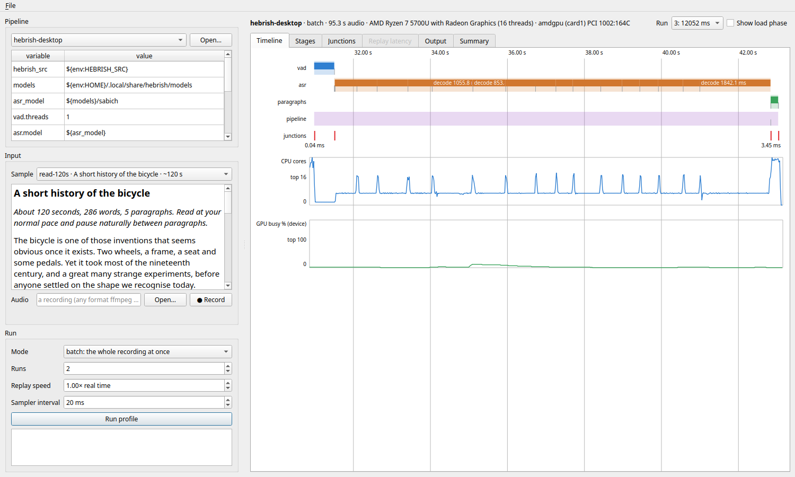

# ASR Pipeline Profiler

See how a **multi-model local speech-to-text pipeline** actually runs: each stage's CPU, GPU and
memory use, how long each model call takes, and the **junctions**, the small gaps between one
model finishing and the next one starting.



## Why

A local dictation app is rarely one model. A typical flow runs voice activity detection (VAD),
then the ASR model, then smaller models for paragraph breaks or punctuation, and maybe an LLM
clean-up pass, all on one machine and all close to real time. There is plenty of tooling for
benchmarking **one model**: its accuracy, its tokens per second, its memory. There is very little
for seeing the **pipeline**: which stage holds the CPU, whether a stage really uses the threads
you gave it, what each model costs in RAM, whether anything reaches the GPU, and how much time
goes on the handoffs between stages instead of on inference.

This tool profiles the pipeline as a whole. It was built for the
[Hebrish](https://hebrish.app) desktop app (Silero VAD → Parakeet TDT via sherpa-onnx → a
paragraph-break model in ONNX Runtime), which is the worked example. The core is not tied to
Hebrish: a pipeline is a TOML file of stages, and a stage is a small adapter class around your
own code. Use it as a template for profiling your own multi-step local ASR flow.

## What it measures

| | |
| --- | --- |
| **Per stage** | wall time, time inside model calls vs glue code, calls, CPU average and peak (in cores), how many threads were really busy, peak RSS, GPU busy % and VRAM, execution provider (CPU, CUDA, …) |
| **Load** | per stage: load time split into steps (session creation, warm-up), resident memory added |
| **Junctions** | between each pair of stages: from the end of one stage's last model call to the start of the next stage's first, with the glue steps inside it by name and the unaccounted remainder |
| **Gaps** | the same inside a stage: between the ASR's pieces, between a token classifier's windows |
| **Replay latency** | with the audio fed in real time: for each speech segment, end of speech → text (VAD closing time + junction + ASR), plus how far processing fell behind the audio |
| **Quality** | against a reading sample: WER, and paragraph breaks found vs placed (precision, recall, F1) |

Concepts and measurement method in detail: [docs/concepts.md](docs/concepts.md).

## Install (Ubuntu)

```bash
git clone https://github.com/Hebrish-ASR/ASR-Pipeline-Profiler
cd ASR-Pipeline-Profiler
sudo apt install python3-pyside6.qtwidgets ffmpeg libportaudio2   # GUI, audio decoding, recording
uv venv --system-site-packages --python /usr/bin/python3   # the distro Python, so the venv sees apt's PySide6
uv pip install -e '.[hebrish,test]'   # the Hebrish example's runtimes too
```

Run it from the checkout: the pipeline files (`pipelines/`) and reading samples (`samples/`) live
there, not in the package. Linux only for now; the sampler reads `/proc`.

## Use

**GUI.** `.venv/bin/asrprof gui`. Pick a pipeline, edit its variables (model paths, threads,
provider), pick a reading sample and record yourself reading it (or open any recording), choose
batch or replay, and run. The profile runs in a child process, so the GUI's own CPU never shows
up in the numbers. Tabs: Timeline, Stages, Junctions, Replay latency, Output, Summary.

**CLI.**

```bash
asrprof samples                       # the reading samples: ~30 s, ~60 s, ~120 s, with paragraphs
asrprof record read-60s               # read one aloud into the default microphone
asrprof run pipelines/hebrish-desktop.toml --audio take.wav --sample read-60s --repeat 3
asrprof run pipelines/hebrish-desktop.toml --audio take.wav --mode replay --var asr.threads=8
asrprof show report.json
```

`--json` prints the report to stdout (progress goes to stderr), which suits agents and scripts.
Reports are saved under `~/.local/share/asrprof/reports/`; format in
[docs/report-schema.md](docs/report-schema.md).

**Server.** `asrprof serve --host 0.0.0.0 --port 8765` takes audio over HTTP and returns the
report, for profiling on a server or from a benchmarking agent on another machine:
[docs/server.md](docs/server.md).

## The Hebrish example

`pipelines/hebrish-desktop.toml` is the desktop app's Transcription Mode. The adapters import
the app's own `hebrish` package (set `HEBRISH_SRC` to a checkout's `desktop/` folder, or install
the .deb) and call its functions one step at a time, so the spans follow the app's real code path.
Models are read from the app's model folder (`~/.local/share/hebrish/models`).

```bash
HEBRISH_SRC=~/src/Hebrish-App/desktop asrprof run pipelines/hebrish-desktop.toml \
    --audio take.wav --sample read-60s --repeat 2
```

The first measurements, and what they show, are in
[docs/findings/2026-10-29-hebrish-desktop.md](docs/findings/2026-10-29-hebrish-desktop.md).

## Your own pipeline

Copy `pipelines/hebrish-desktop.toml`, then point each stage at an adapter. For a text stage
that is just a function, the builtin `python` adapter is enough (`callable = "pkg.mod:fn"`).
Otherwise write a small class: [docs/adapters.md](docs/adapters.md). The adapter decides which
code counts as a model call and which as glue, and that split is what makes junctions
measurable.

## Limits

- Linux only (`/proc` sampling). GPU telemetry: NVIDIA through NVML (with per-process VRAM), AMD
  through amdgpu sysfs (busy % for the whole device, not per process). With no telemetry, GPU
  columns are empty, which does not mean the GPU was idle.
- Stages run in this process. A stage that calls out to a separate server (llama.cpp, Ollama, a
  remote API) shows its wall time and junctions, but its CPU and memory belong to that other
  process and are not counted.
- Replay runs the pipeline on one processing thread: while the ASR decodes a segment, the VAD
  waits. That is a common simple design, and the chunk-lag figure shows what it costs.

## Licence

MIT. The Hebrish models and app have their own licences.
